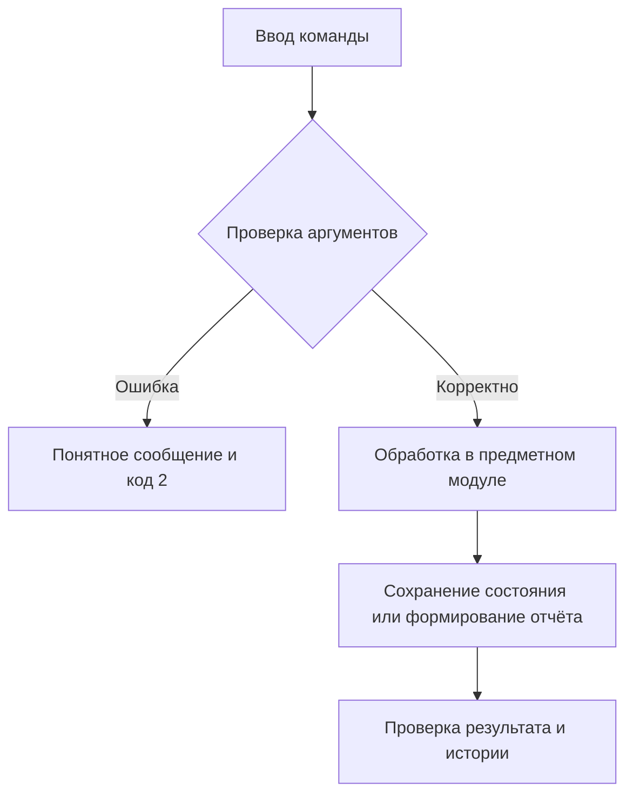

# Отчёт. Практическая работа №19–20

## Задание 6. Автоматизация программных релизов

Дата: 5 ноября 2026 года.

## Цель

Разработать работающее приложение по заданию 6, проверить корректность,
организовать версионность и документировать применённые практики управления конфигурацией.

## Архитектура

core: SemVer, bump, register и check_tag; отдельные workflow обычного CI и релизной сборки.

Стек: Python 3.11/3.12, стандартная библиотека, pytest 8.3.5, ruff 0.11.13;
сборщик hatchling 1.27.0. Зависимости фиксируются в pyproject.toml и uv.lock.
Консольный интерфейс — src/release_manager/cli.py, логика — src/release_manager/core.py,
тесты — tests/.

## Схема алгоритма

Обычный push/PR → pytest без обязательного тега; push v* → строгое сравнение тега и project.version → тесты → wheel + sdist → Artifacts.



## Основной фрагмент реализации

Код из src/release_manager/core.py, функция check_tag:

```python
def check_tag(project, tag):
    if not tag:
        raise ValueError("Отсутствует релизный Git-тег")
    if not tag.startswith("v"):
        raise ValueError("Тег должен иметь формат vX.Y.Z")
    parse_version(tag[1:])
    if tag[1:] != package_version(project):
        raise ValueError("Версия Git-тега не соответствует версии пакета")
    return tag
```

Полный исходный код находится рядом с отчётом. Для защиты работы следует разобрать
его самостоятельно; происхождение реализации не представляется как подтверждение
самостоятельного написания студентом.

## Запуск и полученные результаты

Команда демонстрации: `uv run python examples/demo.py` в отдельно клонированном проекте;
в общем workspace: `uv run --all-packages python release-manager/examples/demo.py` из корня.

```text
{'bump': {'major': '2.0.0', 'minor': '1.3.0', 'patch': '1.2.4'}, 'success': 'v1.0.0', 'rejected:v1.0.1': 'Версия Git-тега не соответствует версии пакета', 'rejected:vbad': 'Версия должна иметь формат MAJOR.MINOR.PATCH без ведущих нулей', 'rejected:': 'Отсутствует релизный Git-тег'}
```

Основное свидетельство: [examples/release-checks.json](examples/release-checks.json).
Локальные тесты: **18 passed in 0.01s**. Ruff и справка CLI: успешно.
Полный протокол: [examples/verification.txt](examples/verification.txt).
Общий набор: **94 теста пройдены на Python 3.12.14 и Python 3.11.16**.
Эти протоколы получены локально и не выдаются за GitHub Actions.

## Git и прослеживаемость

Каждый каталог — отдельный настоящий Git-репозиторий. История создавалась по этапам:
настройка пакета → функции → CLI → тесты → документация → демонстрации и проверка.
Функциональные ветки сохраняются после локального слияния; дата коммитов не подменялась.
Тег v1.0.0 фиксирует завершённое локальное состояние.

```text
feature-core
main
```

Проверка: `git log --graph --oneline --all`, `git branch`, `git tag`, `git show v1.0.0`.
Подробные снимки всех репозиториев собраны в ../git-evidence.json.

Проверены локальные релизные сценарии:

- v1.0.0: код 0, созданы wheel и sdist;
- v1.0.1: код 2, несоответствие версии, артефакты не созданы;
- vbad: код 2, неверный формат, артефакты не созданы.

Логи: examples/build-v1.0.0.txt, build-v1.0.1.txt, build-vbad.txt.
Отдельный scripts/release_build.py повторяет порядок проверок релизного workflow.
Обычные push/PR запускают тесты без обязательного наличия тега.
После изменения версии через register требуется `uv lock` и фиксация обоих файлов.
Установка wheel: `uv tool install dist/release_manager-1.0.0-py3-none-any.whl`.

## Подтверждения GitHub Actions

- [Push main: успешный CI](https://github.com/darklezzzz/release-manager/actions/runs/42021370327) — success.
- [Pull request: успешный CI](https://github.com/darklezzzz/release-manager/actions/runs/42021440317) — success.
- [Релиз v1.0.0: wheel и sdist](https://github.com/darklezzzz/release-manager/actions/runs/42021370495) — success.
- [Релиз v1.0.1: отказ до сборки](https://github.com/darklezzzz/release-manager/actions/runs/42021492986) — failure.

## Ограничения и вывод

Поддерживается запрошенное подмножество SemVer MAJOR.MINOR.PATCH без prerelease/build. Регистрация двух файлов рассчитана на одного оператора; публикации в PyPI нет.

Приложение выполняет локальные функциональные требования и имеет автоматизированные
проверки. Реализованные практики SCM и организационные правила описаны в SCMP.md.
Использование отдельных принципов ISO/IEC/IEEE 828:2012 не доказывает полного
соответствия стандарту. GitHub-подтверждения, где они требуются, собраны в CI_EVIDENCE.md.

Репозиторий: [darklezzzz/release-manager](https://github.com/darklezzzz/release-manager).
